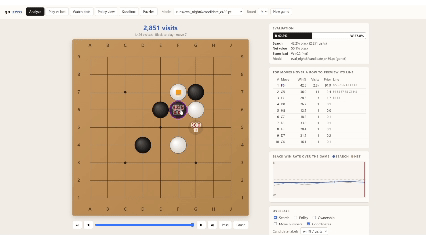

# AlphaZero-Style Go Bot

A 9×9 Go AI built from scratch following the AlphaGo Zero approach: a PyTorch policy/value network guiding Monte Carlo Tree Search, trained only through self-play on one laptop GPU. **It reached a rating of ≈2854 on the Computer Go Server (CGOS) 9×9** after 161 rated games against other bots, winning 41% of its games against bots rated 2900+. I later adapted the same approach to chess: see [AlphaZero-Chess](https://github.com/colinHuang314/AlphaZero-Chess).



## Results


| | |
|---|---|
| **CGOS 9×9 rating** | **≈2854** (161 games, Oct 2026), up from 2630 for the first deployed network |
| vs the original version of this bot | 395–5 after one night of training (equal search) |
| vs GNU Go 3.8 (level 10) | 100–0 |
| Training | 504,065 self-play games, 13M positions, ~430 GPU-hours on an RTX 4060 Laptop |
| Final network | 20 residual blocks × 128 channels, 5.95M parameters |
| Self-play speed | ~12,000 network evaluations/s, about 48× the original version |

Full data, methods and analysis, including the loss analysis and every match, are in [go/docs/RESULTS.md](go/docs/RESULTS.md).

## Overview (`go/`)
- **Network:** ResNet with policy, value, score and ownership heads; 16 input planes relative to the player to move (stones, group liberties, illegal points, last 4 moves). Grown from 10 to 15 to 20 blocks during training by adding identity-initialised residual blocks, so each bigger net starts exactly as strong as the last.
- **Search:** PUCT MCTS batched across 256 games per GPU call, Dirichlet root noise, playout cap randomization, symmetry pruning, tree reuse; numba rules engine (Tromp-Taylor scoring, positional superko); CUDA graphs and GPU work overlapped with tree search, with self-play in two processes.
- **Training:** continuous self-play with a replay buffer and random symmetry augmentation; value target blended with the search's own evaluation; learning-rate and search-depth schedule driven by measured plateaus.
- **Measuring strength:** 200-game matches against frozen earlier models (paired openings, 95% intervals), a calibrated yardstick against KataGo at fixed visits, and the public CGOS rating.
- **Game engine (GTP):** clock-based time management, pondering on the opponent's time, komi correction, resignation. It plays on CGOS and in GTP programs like Sabaki.
- **Interactive UI:** analyze positions with live MCTS, play the bot, watch two models play, inspect policy priors and ownership, test life-and-death puzzles, and compare its search with KataGo's move by move.

## What I learned
- **Self-play Elo overstates progress.** Gains against my own earlier networks were often much larger than gains against outside engines, so I built a KataGo-based yardstick anchored to the bot's real CGOS rating.
- **Plateaus have a pattern.** On a fixed network, each learning-rate drop or deeper search target gave one jump of +80 to +190 Elo and then flattened; once the 10-block network stopped responding, only a bigger network helped (+235, then +67).
- **Find the weakness before tuning.** Re-checking 377 lost games with KataGo showed the losses turn around move 20, from small positional misjudgments rather than blunders, which pointed at the network's value judgment and network size.
- **Engineering speed is strength.** Batching, CUDA graphs and parallel self-play made training ~48× faster than my first version, which is what made 500,000 games possible on a laptop.

## What I debugged
In the original version: temperature-schedule bugs, and eye-filling and self-atari loops. Found while rebuilding it: root noise that was never applied and a network input that dropped the move history at the root. In the rewrite: a komi mismatch that turned White's half-point wins into draws on CGOS, a pipe deadlock in the KataGo analysis tool, and self-play workers that died when their console windows were closed.

## Development notes
I wrote the original Go engine myself from the AlphaGo Zero paper (see the early commit history). The improved version was built with AI-assisted development (Claude): I designed the architecture, training pipeline and experiments, chose what to test next from the results, and debugged and evaluated the models.

## Try it
Weights: [Releases](https://github.com/colinHuang314/AlphaZero-Style-Go-Bot/releases)

```bash
pip install -r requirements.txt

# browser UI at http://localhost:8765
cd go
python -m gozero.ui.server --model path/to/go-zero-9x9-c439.pt

# play over GTP with the CGOS settings
python -m gozero.gtp --model path/to/model.pt --visits 50000 --time-manage --tm-use 0.85 --komi-fix --ponder --resign -0.97
```

More in [go/README.md](go/README.md).
