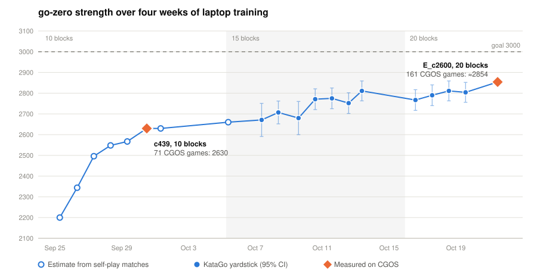

# go-zero

A rebuilt AlphaZero-style Go engine for 9×9 (and smaller boards), based on
[AlphaZero-Style-Go-Bot](https://github.com/colinHuang314/AlphaZero-Style-Go-Bot).
It is fully standalone: the original checkpoints are copied into `anchors/` and
serve only as fixed opponents for measuring progress.

Trained purely by self-play (zero human or engine data; KataGo is used only as a measuring opponent)
on one laptop GPU (RTX 4060 Laptop) over four weeks, Sep 24 – Oct 22, 2026.

**Final result: CGOS 9×9 rating ≈2854** after 161 rated games (`gz-c2600-4060-tm85`, Oct 21–22), up
from 2630 for the first deployed net. Full data, methods and analysis: [docs/RESULTS.md](docs/RESULTS.md).



## Results

| Milestone | Result |
|---|---|
| vs the original `AZNET9_epoch_300` (night 1, cycle 79) | 395–5 (98.8%) at 400 visits |
| vs GNU Go 3.8 level 10 (c392, Sep 29) | 100–0 |
| CGOS 9×9 as `gz-c439-4060-tm85` (10 blocks, Oct 2) | 2630 after 71 games |
| Run D, 15 blocks: D_c1894 vs C_c611 (best 10-block net) | 159–41, +235 Elo (200 games, 400 visits) |
| Run E, 20 blocks: E_c2600 vs D_c1894 | 119–81, +67 Elo; vs C_c611 169–31, +295 |
| Yardstick vs KataGo@1 visit, our net at 800 visits (200 games) | D_c1736 83 (≈2811), E_c2470 81 (≈2804) |
| **CGOS 9×9 as `gz-c2600-4060-tm85` (20 blocks, pondering, Oct 21–22)** | **≈2854 after 161 games**; 32.5/79 vs bots rated 2900+ |

In total: 504,065 self-play games, 13M training positions, ~430 GPU-hours, 2,600 training cycles.
The yardstick (`tools/yardstick.py`) puts each net on the CGOS scale through c439's measured rating.
`NOTES.md` is the night-by-night log and `PLAN.md` the day-by-day plan.

## Quick start

```
pip install -r requirements.txt
python -m pytest                      # rules, features, MCTS, self-play, replay tests
python -m gozero.loop --config configs/9x9.yaml --run runs/9x9_a --hours 9
```
Stop anytime with Ctrl+C (or create `STOP` in the run folder to stop after the current cycle).
Rerunning the same command resumes from where it left off. `configs/9x9.yaml` is the original 10-block
setup; the final net came from `configs/laptop_e_lr.yaml` (20 blocks, 2 self-play worker processes),
grown from smaller nets with `tools/deepen.py`.

Evaluate and diagnose:
```
python tools/match.py runs/9x9_a/latest.pt anchors/AZNET9_epoch_300.pt --pairs 200 --visits 400
python tools/diagnose.py runs/9x9_a/latest.pt --val runs/9x9_a/val_buffer.npz
tensorboard --logdir runs
python tools/yardstick.py runs/exp_e/latest.pt --kata-visits 1     # needs KataGo in tools/katago/
```

Play over GTP (CGOS, GNU Go, KataGo, Sabaki, ...), with the flags used for CGOS:
```
python -m gozero.gtp --model go-zero-9x9-E_c2600.pt --visits 50000 --time-manage --tm-use 0.85 --komi-fix --ponder --resign -0.97
```

## Layout

| Path | What |
|---|---|
| `gozero/go/` | numba rules engine (Tromp-Taylor, positional superko), features, symmetries |
| `gozero/nn/` | ResNet with policy / value / score / ownership heads |
| `gozero/mcts/` | PUCT search batched across many games, evaluators (new net, legacy net, test players) |
| `gozero/selfplay/` | continuous self-play with playout cap randomization; `workers.py` runs it in several processes |
| `gozero/train/` | replay buffer (augmentation at sample time), trainer |
| `gozero/eval/` | arena with paired openings, Wilson intervals, Elo |
| `gozero/legacy/` | copies of the original rules / network for loading anchors and cross-checking |
| `gozero/loop.py` | the continuous training loop |
| `gozero/gtp.py` | GTP engine: time management, pondering, komi fix, resign |
| `gozero/ui/` | browser UI (see below) |
| `configs/` | run configs (`laptop_*.yaml` = the experiments in `PLAN.md`), KataGo yardstick config |
| `tools/match.py` | match between two checkpoints with paired openings |
| `tools/diagnose.py` | component diagnostics (policy, value, ownership, search) |
| `tools/gtp_match.py` | referee between any two GTP programs |
| `tools/yardstick.py` | strength vs KataGo at fixed visits, on the CGOS scale |
| `tools/cgos_report.py` | CGOS game report and blind-spot positions |
| `tools/sp_bench.py` | self-play speed at different worker counts |
| `tools/deepen.py` | add residual blocks to a trained net without changing its output |
| `tools/rating_chart.py` | redraws `docs/rating_history.svg` |
| `tools/cloud/` | scripts for training on a rented GPU |
| `docs/RESULTS.md` | final results, methods, loss analysis, CGOS games |
| `NOTES.md` | how to read the metrics and adjust hyperparameters; night-by-night log |
| `PLAN.md` | goals, results and schedule as the project went |

## Differences from the original project

| Area | Original | Here |
|---|---|---|
| Network | 14 residual blocks × 128 channels (4.17M parameters) | 20 × 128 (5.95M) with score and ownership heads, grown from 10 → 15 → 20 blocks |
| Policy target | visit counts *after* temperature (one-hot after move 18) | raw visit distribution |
| Root noise | never applied (bug) | Dirichlet at every self-play root with a full search |
| Net input | 8 boards of absolute history; root saw no history (bug) | relative stones, liberties, illegal points, last moves, "opponent passed" |
| Pass handling in search | ignored a pass made before the root | terminal detection uses the real pass count |
| Priors | floored at `MIN_PRIOR=0.01` | plain masked softmax |
| Ko | simple ko | positional superko |
| Speed | ~250 evals/s, one position per GPU call | ~12,000 evals/s, about 48× (256 games batched, numba rules, CUDA graphs, GPU work overlapped with tree search, 2 self-play processes); one-game search ~5,500 visits/s |
| Search | plain PUCT | symmetric moves searched once (on symmetric boards), FPU reduction, tree reuse between moves |
| Training scheme | gating arena, 16 games at 53% | continuous training, progress tracked against fixed anchors |
| Data reuse | ~40× per position (8 stored augmentations × passes) | ~4 samples per new sample, symmetry drawn at random |
| Extra targets | none | ownership and final score (KataGo) |
| Search budget | time-based | self-play: fixed visits with full/fast playout cap randomization; GTP: clock-based time management, pondering on the opponent's time |

## Interactive UI

```
python -m gozero.ui.server            # opens http://localhost:8765
python -m gozero.ui.server --model anchors/AZNET9_epoch_300.pt
```

A browser UI in the same style as the original (wooden board, translucent
candidate stones scaled by visits, red numbers, purple = best, green = close
alternatives, orange = last move), with more information:

| Mode | What it does |
|---|---|
| Analyze | live search on the current position (tree reused as you play); click to place stones |
| Play vs bot | choose your color and the bot's visits per move; hints off by default (press Analyze to turn them on) |
| Watch bots | any two checkpoints play each other, e.g. the new model vs `AZNET9_epoch_300` |
| Policy view | raw network move probabilities, no search |
| Sandbox | free play for testing rules; shows the Tromp-Taylor area score of the board |
| Puzzles | set up positions stone by stone, mark the answer, save to `problems/`, and test any model on one puzzle or all of them (move distribution at N visits, default 800) |
| Compare vs KataGo | go-zero and KataGo search the same position with equal visits side by side (where they agree, how much our move loses in KataGo's eyes), plus a visits ladder 1 / 16 / 100 / 800 / 3200 for both engines. Display only; needs KataGo in `tools/katago/` |

Side panel: black/white win-rate bar (search and raw net), score lead (score head),
top-moves table with win rate, visits, prior and principal variation (hover a row
to preview the line on the board, or hold Shift over a candidate), and a win-rate
graph over the game (click to jump). Overlays: search, policy, ownership (the
ownership head's territory estimate, plus markers on stones it thinks are dead),
move numbers, coordinates. Save / load SGF. Keys: ←/→, Home/End, P = pass,
Space = pause analysis. Old AZNet checkpoints work too (no score / ownership heads).
